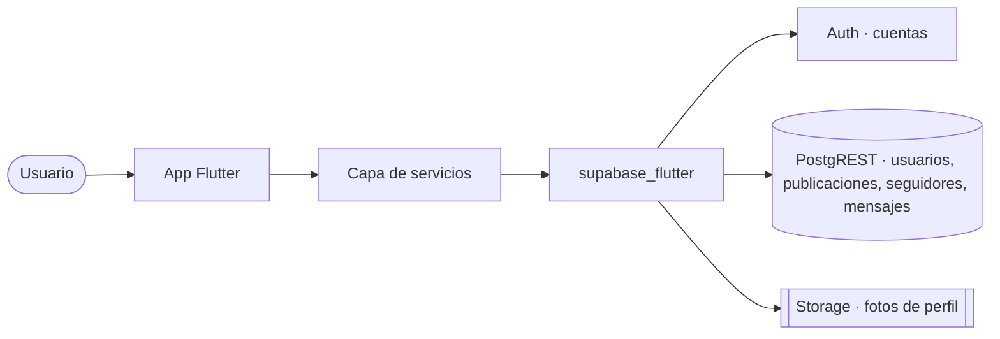

# La arquitectura: Flutter + Supabase

<!-- tags: architectural spine, invariantes, Supabase Auth, GoTrue, PostgREST, Supabase Storage, supabase_flutter, publishable key, capa de servicios, stack tecnológico, diagrama mermaid, secret key en la app -->

La app de tu equipo es un frontend en Flutter con el backend de Supabase. No hay servidor propio.

## Tres servicios, un SDK

```svg
<svg id="arServicios" xmlns="http://www.w3.org/2000/svg" viewBox="0 0 960 476" width="100%" style="max-width:960px;display:block;margin:0 auto" role="img" aria-labelledby="arServicios-ttl arServicios-dsc" font-family="ui-sans-serif, -apple-system, 'Segoe UI', Inter, Roboto, Helvetica, Arial, sans-serif">
  <title id="arServicios-ttl">La app y los tres servicios de Supabase</title>
  <desc id="arServicios-dsc">A la izquierda la app Flutter en tres capas: pantallas, servicios y el SDK supabase_flutter, con la publishable key. A la derecha Supabase con Auth para las cuentas, la base de datos con PostgREST para usuarios, publicaciones, seguidores y mensajes, y Storage para las fotos de perfil.</desc>
  <defs>
    <style>
      #arServicios .title{fill:#161A26;font-size:22px;font-weight:700}
      #arServicios .sub{fill:#79809A;font-size:13.5px}
      #arServicios .h{font-size:12px;font-weight:700;letter-spacing:.08em;fill:#556074}
      #arServicios .nt{font-size:15px;font-weight:700;fill:#161A26}
      #arServicios .nb{fill:#454C61;font-size:13px}
      #arServicios .lbl{fill:#556074;font-size:12px;font-weight:600}
      #arServicios .foot{fill:#79809A;font-size:12px}
      #arServicios .mono{font-family:ui-monospace, SFMono-Regular, 'SF Mono', Menlo, Consolas, monospace}
      #arServicios .link{fill:none;stroke:#556074;stroke-width:1.75;marker-end:url(#arServicios-arrow)}
    </style>
    <marker id="arServicios-arrow" viewBox="0 0 10 10" refX="9" refY="5" markerWidth="7" markerHeight="7" markerUnits="strokeWidth" orient="auto-start-reverse">
      <path d="M0,0 L10,5 L0,10 L2.4,5 Z" fill="#556074"/>
    </marker>
  </defs>
  <rect width="960" height="476" rx="16" fill="#FBFBFD"/>
  <text class="title" x="48" y="56">La app y los tres servicios de Supabase</text>
  <text class="sub" x="48" y="80" data-fit="860">Un solo SDK en la app; detrás, tres servicios con un trabajo cada uno.</text>
<rect x="48" y="112" width="340" height="320" rx="16" fill="#FFFFFF" stroke="#C4CBD8" stroke-width="1.5"/><text x="68" y="142" font-size="15" font-weight="700" fill="#161A26" text-anchor="start" data-fit="116">App Flutter</text><g><rect x="68" y="160" width="300" height="72" rx="12" fill="#EEF1FF" stroke="#A9B4F2" stroke-width="1.5"/><text x="84" y="192" font-size="13.5" font-weight="700" fill="#4453C9" text-anchor="start" data-fit="276">Screens y Pages</text><text x="84" y="218" font-size="13" font-weight="400" fill="#454C61" text-anchor="start" data-fit="276">Muestran y piden datos.</text></g><path class="link" d="M218,232 V246"/><g><rect x="68" y="248" width="300" height="72" rx="12" fill="#F4EBFF" stroke="#C9A6EE" stroke-width="1.5"/><text x="84" y="280" font-size="13.5" font-weight="700" fill="#7439B8" text-anchor="start" data-fit="276">Servicios</text><text x="84" y="306" font-size="13" font-weight="400" fill="#454C61" text-anchor="start" data-fit="276">Los únicos que hablan con Supabase.</text></g><path class="link" d="M218,320 V334"/><g><rect x="68" y="336" width="300" height="72" rx="12" fill="#EFF1F5" stroke="#C4CBD8" stroke-width="1.5"/><text x="84" y="368" font-size="13.5" font-weight="700" fill="#556074" text-anchor="start" class="mono" data-fit="276">supabase_flutter</text><text x="84" y="394" font-size="13" font-weight="400" fill="#454C61" text-anchor="start" data-fit="276">Un solo SDK con los tres servicios.</text></g><rect x="238.6" y="344" width="122.8" height="24" rx="12" fill="#E8F6E3" stroke="#9FD68D" stroke-width="1.2"/><text x="300" y="360.5" font-size="12" font-weight="700" fill="#3A8235" text-anchor="middle" data-fit="124">publishable key</text><rect x="508" y="112" width="404" height="320" rx="16" fill="#E8F6E3" stroke="#9FD68D" stroke-width="1.5"/><text x="528" y="142" font-size="15" font-weight="700" fill="#3A8235" text-anchor="start" data-fit="91">Supabase</text><g><rect x="528" y="160" width="364" height="72" rx="12" fill="#FFF3DC" stroke="#F0C572" stroke-width="1.5"/></g><text x="544" y="186" font-size="14" font-weight="700" fill="#A96C05" text-anchor="start" data-fit="55">Auth</text><text x="593.36" y="186" font-size="12" font-weight="400" fill="#79809A" text-anchor="start" data-fit="200">antes GoTrue</text><text x="544" y="206" font-size="12.5" font-weight="400" fill="#454C61" text-anchor="start" data-fit="340">Cuentas: registro, inicio y</text><text x="544" y="223" font-size="12.5" font-weight="400" fill="#454C61" text-anchor="start" data-fit="340">cierre de sesión. Da el uuid.</text><g><rect x="528" y="248" width="364" height="72" rx="12" fill="#E3F6F3" stroke="#86D3CA" stroke-width="1.5"/></g><text x="544" y="274" font-size="14" font-weight="700" fill="#0F8478" text-anchor="start" data-fit="125">Base de datos</text><text x="663.9200000000001" y="274" font-size="12" font-weight="400" fill="#79809A" text-anchor="start" data-fit="200">Postgres + PostgREST</text><text x="544" y="294" font-size="12.5" font-weight="400" fill="#454C61" text-anchor="start" data-fit="340">usuarios, publicaciones,</text><text x="544" y="311" font-size="12.5" font-weight="400" fill="#454C61" text-anchor="start" data-fit="340">seguidores y mensajes.</text><g><rect x="528" y="336" width="364" height="72" rx="12" fill="#FFEBEF" stroke="#F3A3B2" stroke-width="1.5"/></g><text x="544" y="362" font-size="14" font-weight="700" fill="#C2354F" text-anchor="start" data-fit="78">Storage</text><text x="616.88" y="362" font-size="12" font-weight="400" fill="#79809A" text-anchor="start" data-fit="200">buckets de archivos</text><text x="544" y="382" font-size="12.5" font-weight="400" fill="#454C61" text-anchor="start" data-fit="340">Las fotos de perfil.</text><text x="544" y="399" font-size="12.5" font-weight="400" fill="#454C61" text-anchor="start" data-fit="340">La tabla guarda la ruta.</text><path class="link" d="M368,380 C440,380 440,196 526,196"/><path class="link" d="M368,380 C440,380 440,284 526,284"/><path class="link" d="M368,380 C440,380 440,372 526,372"/><text x="48" y="448" font-size="12" font-weight="400" fill="#79809A" text-anchor="start" data-fit="864">Sin backend propio: la app habla directo con Supabase. La secret key nunca va en la app.</text></svg>
```

- **Auth** (antes GoTrue): cuentas y sesiones. Cada usuario tiene un `uuid`.
- **Base de datos**: Postgres, expuesto como API por PostgREST.
- **Storage**: archivos en buckets.

La app los usa todos con el paquete `supabase_flutter` y la **publishable key** del proyecto. La secret key nunca va en la app.

## Un pedido, fila por fila

```svg
<svg id="arRecorrido" xmlns="http://www.w3.org/2000/svg" viewBox="0 0 960 470" width="100%" style="max-width:960px;display:block;margin:0 auto" role="img" aria-labelledby="arRecorrido-ttl arRecorrido-dsc" font-family="ui-sans-serif, -apple-system, 'Segoe UI', Inter, Roboto, Helvetica, Arial, sans-serif">
  <title id="arRecorrido-ttl">Cuatro pedidos de la red profesional</title>
  <desc id="arRecorrido-dsc">Cuatro filas con tres columnas, pantalla, servicio y Supabase: iniciar sesión va a Auth y vuelve el uuid; ver el feed lee publicaciones por PostgREST; cambiar la foto sube el archivo a Storage y vuelve la ruta; guardar la ruta actualiza la fila del usuario por PostgREST.</desc>
  <defs>
    <style>
      #arRecorrido .title{fill:#161A26;font-size:22px;font-weight:700}
      #arRecorrido .sub{fill:#79809A;font-size:13.5px}
      #arRecorrido .h{font-size:12px;font-weight:700;letter-spacing:.08em;fill:#556074}
      #arRecorrido .nt{font-size:15px;font-weight:700;fill:#161A26}
      #arRecorrido .nb{fill:#454C61;font-size:13px}
      #arRecorrido .lbl{fill:#556074;font-size:12px;font-weight:600}
      #arRecorrido .foot{fill:#79809A;font-size:12px}
      #arRecorrido .mono{font-family:ui-monospace, SFMono-Regular, 'SF Mono', Menlo, Consolas, monospace}
      #arRecorrido .link{fill:none;stroke:#556074;stroke-width:1.75;marker-end:url(#arRecorrido-arrow)}
    </style>
    <marker id="arRecorrido-arrow" viewBox="0 0 10 10" refX="9" refY="5" markerWidth="7" markerHeight="7" markerUnits="strokeWidth" orient="auto-start-reverse">
      <path d="M0,0 L10,5 L0,10 L2.4,5 Z" fill="#556074"/>
    </marker>
  </defs>
  <rect width="960" height="470" rx="16" fill="#FBFBFD"/>
  <text class="title" x="48" y="56">Cuatro pedidos de la red profesional</text>
  <text class="sub" x="48" y="80" data-fit="860">Una fila por pedido. Cada uno pasa por la capa de servicios y llega a un servicio.</text>
<text x="48" y="124" font-size="12" font-weight="700" fill="#556074" text-anchor="start" data-fit="77">PANTALLA</text><text x="360" y="124" font-size="12" font-weight="700" fill="#556074" text-anchor="start" data-fit="77">SERVICIO</text><text x="648" y="124" font-size="12" font-weight="700" fill="#556074" text-anchor="start" data-fit="77">SUPABASE</text><g><rect x="48" y="140" width="264" height="56" rx="12" fill="#EEF1FF" stroke="#A9B4F2" stroke-width="1.5"/></g><text x="64" y="174" font-size="14" font-weight="700" fill="#4453C9" text-anchor="start" data-fit="133">Iniciar sesión</text><g><rect x="360" y="140" width="240" height="56" rx="12" fill="#F4EBFF" stroke="#C9A6EE" stroke-width="1.5"/></g><text x="376" y="174" font-size="13.5" font-weight="700" fill="#7439B8" text-anchor="start" class="mono" data-fit="113">AuthService</text><g><rect x="648" y="140" width="264" height="56" rx="12" fill="#FFF3DC" stroke="#F0C572" stroke-width="1.5"/></g><text x="664" y="165" font-size="14" font-weight="700" fill="#A96C05" text-anchor="start" data-fit="55">Auth</text><text x="664" y="184" font-size="12" font-weight="400" fill="#454C61" text-anchor="start" data-fit="240">vuelve la sesión con el uuid</text><path class="link" d="M312,168 H358"/><path class="link" d="M600,168 H646"/><g><rect x="48" y="216" width="264" height="56" rx="12" fill="#EEF1FF" stroke="#A9B4F2" stroke-width="1.5"/></g><text x="64" y="250" font-size="14" font-weight="700" fill="#4453C9" text-anchor="start" data-fit="110">Ver el feed</text><g><rect x="360" y="216" width="240" height="56" rx="12" fill="#F4EBFF" stroke="#C9A6EE" stroke-width="1.5"/></g><text x="376" y="250" font-size="13.5" font-weight="700" fill="#7439B8" text-anchor="start" class="mono" data-fit="113">PostService</text><g><rect x="648" y="216" width="264" height="56" rx="12" fill="#E3F6F3" stroke="#86D3CA" stroke-width="1.5"/></g><text x="664" y="241" font-size="14" font-weight="700" fill="#0F8478" text-anchor="start" data-fit="94">PostgREST</text><text x="664" y="260" font-size="12" font-weight="400" fill="#454C61" text-anchor="start" data-fit="240">vuelven las publicaciones</text><path class="link" d="M312,244 H358"/><path class="link" d="M600,244 H646"/><g><rect x="48" y="292" width="264" height="56" rx="12" fill="#EEF1FF" stroke="#A9B4F2" stroke-width="1.5"/></g><text x="64" y="326" font-size="14" font-weight="700" fill="#4453C9" text-anchor="start" data-fit="141">Cambiar la foto</text><g><rect x="360" y="292" width="240" height="56" rx="12" fill="#F4EBFF" stroke="#C9A6EE" stroke-width="1.5"/></g><text x="376" y="326" font-size="13.5" font-weight="700" fill="#7439B8" text-anchor="start" class="mono" data-fit="137">ProfileService</text><g><rect x="648" y="292" width="264" height="56" rx="12" fill="#FFEBEF" stroke="#F3A3B2" stroke-width="1.5"/></g><text x="664" y="317" font-size="14" font-weight="700" fill="#C2354F" text-anchor="start" data-fit="78">Storage</text><text x="664" y="336" font-size="12" font-weight="400" fill="#454C61" text-anchor="start" data-fit="240">vuelve la ruta del archivo</text><path class="link" d="M312,320 H358"/><path class="link" d="M600,320 H646"/><g><rect x="48" y="368" width="264" height="56" rx="12" fill="#EEF1FF" stroke="#A9B4F2" stroke-width="1.5"/></g><text x="64" y="402" font-size="14" font-weight="700" fill="#4453C9" text-anchor="start" data-fit="141">Guardar la ruta</text><g><rect x="360" y="368" width="240" height="56" rx="12" fill="#F4EBFF" stroke="#C9A6EE" stroke-width="1.5"/></g><text x="376" y="402" font-size="13.5" font-weight="700" fill="#7439B8" text-anchor="start" class="mono" data-fit="137">ProfileService</text><g><rect x="648" y="368" width="264" height="56" rx="12" fill="#E3F6F3" stroke="#86D3CA" stroke-width="1.5"/></g><text x="664" y="393" font-size="14" font-weight="700" fill="#0F8478" text-anchor="start" data-fit="94">PostgREST</text><text x="664" y="412" font-size="12" font-weight="400" fill="#454C61" text-anchor="start" data-fit="240">foto_url en usuarios</text><path class="link" d="M312,396 H358"/><path class="link" d="M600,396 H646"/></svg>
```

## La architectural spine

```svg
<svg id="arSpine" xmlns="http://www.w3.org/2000/svg" viewBox="0 0 960 420" width="100%" style="max-width:960px;display:block;margin:0 auto" role="img" aria-labelledby="arSpine-ttl arSpine-dsc" font-family="ui-sans-serif, -apple-system, 'Segoe UI', Inter, Roboto, Helvetica, Arial, sans-serif">
  <title id="arSpine-ttl">Las partes de la architectural spine</title>
  <desc id="arSpine-dsc">Cinco bloques: resumen, diagrama, stack, invariantes y diferido. Las invariantes están resaltadas, con la pregunta que las define: si dos integrantes pueden decidirlo distinto y eso rompe la app, es una invariante.</desc>
  <defs>
    <style>
      #arSpine .title{fill:#161A26;font-size:22px;font-weight:700}
      #arSpine .sub{fill:#79809A;font-size:13.5px}
      #arSpine .h{font-size:12px;font-weight:700;letter-spacing:.08em;fill:#556074}
      #arSpine .nt{font-size:15px;font-weight:700;fill:#161A26}
      #arSpine .nb{fill:#454C61;font-size:13px}
      #arSpine .lbl{fill:#556074;font-size:12px;font-weight:600}
      #arSpine .foot{fill:#79809A;font-size:12px}
      #arSpine .mono{font-family:ui-monospace, SFMono-Regular, 'SF Mono', Menlo, Consolas, monospace}
      #arSpine .link{fill:none;stroke:#556074;stroke-width:1.75;marker-end:url(#arSpine-arrow)}
    </style>
    <marker id="arSpine-arrow" viewBox="0 0 10 10" refX="9" refY="5" markerWidth="7" markerHeight="7" markerUnits="strokeWidth" orient="auto-start-reverse">
      <path d="M0,0 L10,5 L0,10 L2.4,5 Z" fill="#556074"/>
    </marker>
  </defs>
  <rect width="960" height="420" rx="16" fill="#FBFBFD"/>
  <text class="title" x="48" y="56">Las partes de la architectural spine</text>
  <text class="sub" x="48" y="80" data-fit="860">Una o dos páginas. Lo central son las invariantes.</text>
<g><rect x="48" y="116" width="300" height="60" rx="12" fill="#EFF1F5" stroke="#C4CBD8" stroke-width="1.5"/></g><text x="64" y="140" font-size="14" font-weight="700" fill="#556074" text-anchor="start" data-fit="78">Resumen</text><text x="64" y="160" font-size="12" font-weight="400" fill="#454C61" text-anchor="start" data-fit="276">Qué es la app, dónde corre, con qué backend.</text><g><rect x="48" y="186" width="300" height="60" rx="12" fill="#EEF1FF" stroke="#A9B4F2" stroke-width="1.5"/></g><text x="64" y="210" font-size="14" font-weight="700" fill="#4453C9" text-anchor="start" data-fit="86">Diagrama</text><text x="64" y="230" font-size="12" font-weight="400" fill="#454C61" text-anchor="start" data-fit="276">Un flowchart de mermaid.</text><g><rect x="48" y="256" width="300" height="60" rx="12" fill="#E3F6F3" stroke="#86D3CA" stroke-width="1.5"/></g><text x="64" y="280" font-size="14" font-weight="700" fill="#0F8478" text-anchor="start" data-fit="63">Stack</text><text x="64" y="300" font-size="12" font-weight="400" fill="#454C61" text-anchor="start" data-fit="276">Flutter, supabase_flutter y los tres servicios.</text><g><rect x="48" y="326" width="300" height="60" rx="12" fill="#EFF1F5" stroke="#C4CBD8" stroke-width="1.5"/></g><text x="64" y="350" font-size="14" font-weight="700" fill="#556074" text-anchor="start" data-fit="86">Diferido</text><text x="64" y="370" font-size="12" font-weight="400" fill="#454C61" text-anchor="start" data-fit="276">Lo que no se decide todavía.</text><rect x="380" y="116" width="532" height="270" rx="14" fill="#FFF3DC" stroke="#F0C572" stroke-width="2"/><text x="400" y="148" font-size="15" font-weight="700" fill="#A96C05" text-anchor="start" data-fit="250">Invariantes · AD-01, AD-02…</text><text x="400" y="176" font-size="13" font-weight="600" fill="#161A26" text-anchor="start" data-fit="500">¿Dos integrantes podrían decidirlo distinto, y eso rompería la app?</text><text x="400" y="196" font-size="13" font-weight="400" fill="#454C61" text-anchor="start" data-fit="500">Si sí, se fija aquí con una Regla y lo que Evita.</text><g><rect x="400" y="216" width="492" height="72" rx="12" fill="#FFFFFF" stroke="#F0C572" stroke-width="1.5"/><text x="416" y="248" font-size="13.5" font-weight="700" fill="#A96C05" text-anchor="start" data-fit="468">AD-03 · El usuario es el de Auth</text><text x="416" y="274" font-size="12.5" font-weight="400" fill="#454C61" text-anchor="start" data-fit="468">Regla: toda fila de alguien guarda el uuid de Auth.</text></g><g><rect x="400" y="298" width="492" height="72" rx="12" fill="#FFFFFF" stroke="#F0C572" stroke-width="1.5"/><text x="416" y="330" font-size="13.5" font-weight="700" fill="#A96C05" text-anchor="start" data-fit="468">AD-04 · Los archivos van en Storage</text><text x="416" y="356" font-size="12.5" font-weight="400" fill="#454C61" text-anchor="start" data-fit="468">Regla: la tabla guarda solo la ruta del archivo.</text></g></svg>
```

La spine no es la spec técnica completa. Fija solo las **invariantes**: lo que, si cada integrante decide por su lado, rompe la app.

## La spine de la red profesional

Así queda el diagrama en `docs/architectural_spine.md`:



Y sus invariantes:

- **AD-01 · Sin backend propio.** La app habla directo con Supabase.
- **AD-02 · Una capa de servicios.** Solo los servicios llaman a Supabase.
- **AD-03 · El usuario es el de Auth.** Toda fila de alguien guarda su `uuid`.
- **AD-04 · Los archivos van en Storage.** La tabla guarda solo la ruta.
- **AD-05 · Llaves fuera del código.** La URL y la publishable key se leen de la configuración.

En *Diferido* quedan las Edge Functions, Realtime y la seguridad por filas: la app es ligera y no las usa.
