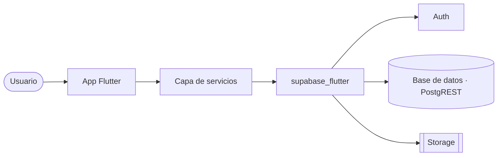

# Architectural spine · Nombre del proyecto

## Resumen

Tres líneas: qué es la app, dónde corre y con qué backend.

## Diagrama

## Stack

- Frontend: Flutter 3.x y Dart 3.x. Plataformas: web y Android.
- SDK: `supabase_flutter`.
- Backend: Supabase con Auth, base de datos (Postgres + PostgREST) y Storage.

## Qué cubre cada servicio

- **Auth**: para qué se usa.
- **Base de datos**: qué tablas guarda (detalle en `docs/modelo.md`).
- **Storage**: qué archivos y en qué bucket.

## Invariantes

### AD-01 · Nombre corto

- **Regla:** lo que siempre se hace.
- **Evita:** el problema que previene.

## Diferido

- Lo que no se decide todavía, y cuándo habría que decidirlo.

## Historial

- 0.1.0 · AAAA-MM-DD · Primera versión.
